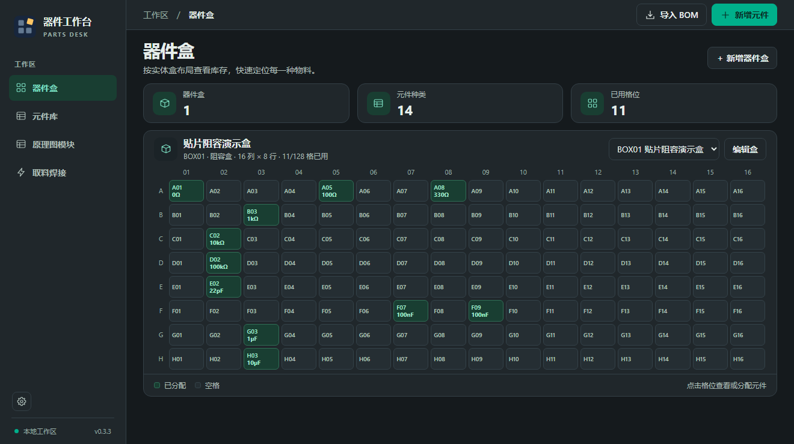
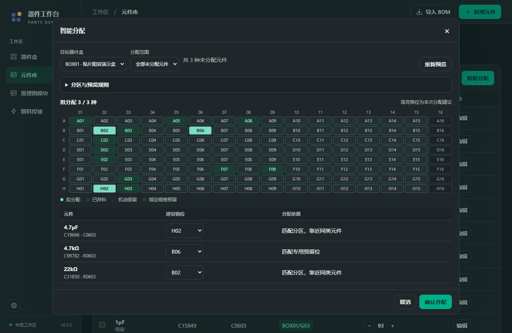
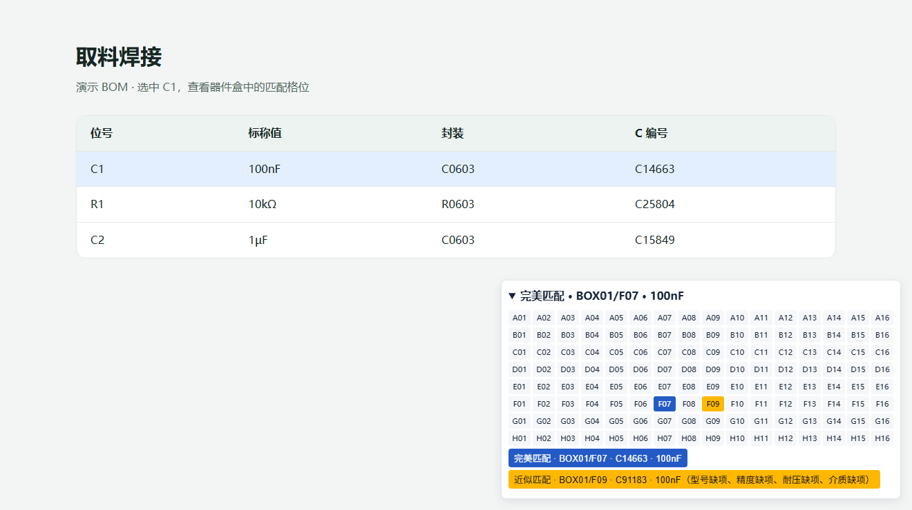

# 器件工作台 · Parts Desk

面向电子工程师和硬件爱好者的 Windows 桌面工具。把元件库存、实体器件盒、BOM 采购和取料焊接放在同一个工作台里。

**[下载 Windows 安装包](https://github.com/lost37/parts-desk-releases/releases/latest)** · [版本记录](https://github.com/lost37/parts-desk-releases/releases) · [反馈问题](https://github.com/lost37/parts-desk-releases/issues/new)

## 界面演示

### 器件盒

按实体盒的行列查看元件。下图是一个 16 × 8 的贴片阻容演示盒。

### 智能分配

为 3 种未分配元件生成建议。下图高亮推荐格位，并列出每项建议的依据，确认前可调整。

### 取料焊接

选中示例 BOM 中的 100nF 电容后，取料面板用蓝色标出完美匹配格位，用黄色标出近似匹配格位。

## 主要功能

| 功能 | 用途 |
| --- | --- |
| 元件库 | 记录 C 编号、型号、封装、库存和存放位置，按关键词、封装、分类或格位状态筛选。 |
| 器件盒与智能分配 | 用自定义行列模拟实体盒。可为全部未分配元件或指定元件推荐格位，支持分区、预留和确认前调整。 |
| BOM 入库 | 导入 CSV、XLS 或 XLSX。预览后选择仅导入信息或按数量补货，可使用阻容盒或兼容盒规则。 |
| 采购核对 | 将原始需求 BOM 与本地库存按 C 编号比对，导出采购差额和核对明细，提醒使用后库存偏低的元件。核对过程不扣库存。 |
| 取料焊接 | 导入嘉立创 EDA 导出的原始离线焊接 HTML，生成带格位提示的副本，可在软件内或浏览器中使用。 |
| 原理图模块 | 从 PDF 或图片提取模块候选，本地识别后人工核对。确认结果可用于在取料焊接页按模块筛选。 |

## 安装与上手

1. 打开[最新版本](https://github.com/lost37/parts-desk-releases/releases/latest)，在 Assets 中下载 `PartsDesk-Setup-*-x64.exe` 并运行。软件支持 Windows x64，运行需要 Microsoft Edge WebView2 Runtime。
2. 在「器件盒」新建与实体盒对应的布局，或使用默认的 16 × 8 盒。在「元件库」录入物料，也可以用「导入 BOM」批量添加。
3. 在「元件库 → 智能分配」选择分配范围，核对建议后保存。焊接时可在「取料焊接」生成带格位提示的辅助页。

## 更新与库存数据

- 在「设置 → 关于 → 软件更新」手动检查并安装新版，也可在「通用」开启启动时检查更新。
- 库存保存在本机 `%LOCALAPPDATA%\PartsDesk\library.json`。软件内更新安装前会自动备份库存。也可在「设置 → 通用」手动导出或恢复 JSON 备份。
- 简体中文为默认语言。首版英语覆盖设置、更新提示和工作台导航。插件市场目前提供预留入口。

本仓库提供 Windows 安装包、更新日志和签名更新清单。

## 许可证与致谢

器件工作台沿用 [Apache License 2.0](LICENSE)。本仓库用于分发桌面安装包和文档，桌面源码目前未在此公开。

项目源于 [ppx2013 的 component-manager](https://gitee.com/ppx2013/component-manager) 扩展工作。桌面版的改动和第三方声明见 [NOTICE](NOTICE)。随安装包提供的第三方组件各自适用其许可证。

## English summary

Parts Desk is a Windows desktop tool for component inventory, physical tray layouts, BOM import, purchasing checks, and part picking during soldering. Download the x64 installer from [the latest GitHub release](https://github.com/lost37/parts-desk-releases/releases/latest). Simplified Chinese is the default. English is available for Settings, update prompts, and workspace navigation.
